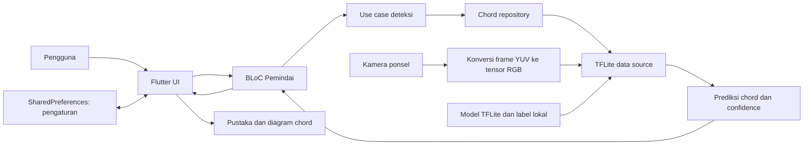

# FretMaster — AI Chord Gitar (Visi Komputer)

Aplikasi Android (Flutter) yang mengenali **8 chord gitar (A, Am, B, C, D, E, F,
G) dari gestur tangan** secara real-time melalui kamera, menggunakan model
TensorFlow Lite MobileNetV2 hasil training ulang dari dataset gambar chord.

> **Catatan model:** `dataset/fretmaster_model.tflite` (dan salinannya di
> `assets/models/`) adalah model **multi-class classification** (output `[1, 8]`
> softmax): MobileNetV2 1.00 @ 224, input `[1, 224, 224, 3]` float32. Urutan
> label output alfabetis: `a_chord, am_chord, b_chord, c_chord, d_chord,
> e_chord, f_chord, g_chord` → ditampilkan sebagai `A, Am, B, C, D, E, F, G`
> (lihat `labels.txt`).
> Training ulang dari nol ada di `D:\kuliyah\smt7\dataset\train_model.py`.

## Fitur

- **Deteksi real-time** — frame kamera YUV_420_888 → rotasi sesuai
  `sensorOrientation` → sampel langsung ke 224×224 RGB → normalisasi
  MobileNetV2 (`x/127.5 − 1`, dapat diubah ke `x/255`) → inferensi TFLite.
- **Overlay pemandu** — bingkai sudut + garis pindai animasi; confidence bar,
  kelas terdeteksi, waktu inferensi, dan riwayat deteksi.
- **Pengaturan deteksi** (ikon slider di layar kamera):
  - *Normalisasi* — `x/127.5 − 1` (MobileNetV2, default) atau `x/255`
  - *Ambang (threshold)* — 10%–90%, default 50% (di bawah ambang → "BUKAN CHORD")
- **Chord Library** — diagram fingering C, D, E, G, A (CustomPainter), nada,
  pola petikan, tips latihan, dan tabel fingering per senar.
- **Halaman Tentang** — spesifikasi model, alur AI, batasan, dan detail dataset.

## Struktur

```
lib/
  main.dart                       # entry point + tema
  src/
    theme.dart                    # palet gelap + aksen amber (Material 3)
    models/chord_info.dart        # data chord C/D/E/G/A + fingering
    services/chord_classifier.dart# wrapper tflite_flutter (input bytes, output [1,8] softmax)
    services/frame_converter.dart # YUV420 -> tensor 224x224x3 (nearest neighbor)
    services/settings_store.dart  # normalisasi / threshold (SharedPreferences)
    screens/                      # home, detection, chord_library, chord_detail, about
    widgets/chord_diagram.dart    # diagram fretboard (CustomPainter)
assets/models/
  fretmaster_model.tflite         # model AI multi-kelas (salinan dari dataset/)
  labels.txt                      # A, Am, B, C, D, E, F, G (urutan = index output)
```

## Menjalankan

```bash
flutter pub get
flutter run          # Android (kamera wajib fisik / emulator dengan kamera)
```

Build APK debug:

```bash
flutter build apk --debug
```

## Catatan Sistematika Proposal

Bagian ini merangkum bahan proposal FretMaster berdasarkan implementasi proyek
saat ini. Identitas anggota dan pembagian tugas perlu disesuaikan dengan kondisi
kelompok.

### 1. Judul dan Identitas Proyek

- **Judul:** FretMaster — Aplikasi Pengenalan Chord Gitar Berbasis Computer Vision
- **Platform:** Android, dikembangkan menggunakan Flutter dan Dart.
- **Deskripsi:** Aplikasi menggunakan kamera ponsel dan model TensorFlow Lite untuk
  mengenali bentuk tangan saat memainkan chord gitar. Hasil prediksi dan
  panduan fingering ditampilkan di aplikasi; inferensi dirancang berjalan
  langsung di perangkat tanpa koneksi internet.

### 2. Latar Belakang dan Permasalahan

Pemain gitar pemula sering kesulitan mengingat bentuk jari dan memastikan chord
yang sedang dimainkan. Panduan teks atau diagram statis juga tidak memberi
umpan balik langsung atas posisi tangan pengguna.

FretMaster dikembangkan sebagai media bantu latihan yang menggabungkan kamera
ponsel dan klasifikasi citra untuk memberikan indikasi chord secara real-time.
Target pengguna utamanya adalah pemula dan pelajar gitar yang ingin mengenali
serta mempelajari chord dasar. Kualitas prediksi bergantung pada pencahayaan,
sudut kamera, posisi tangan, dan kemampuan model; aplikasi ini merupakan alat
bantu latihan, bukan pengganti evaluasi instruktur.

### 3. Tujuan dan Fitur Aplikasi

**Tujuan:** Membuat aplikasi mobile yang dapat membantu pengguna mengenali
gestur chord gitar dan mempelajari bentuk fingering-nya melalui kamera dan
materi visual.

**Fitur utama:**

- **Deteksi melalui kamera:** mengambil frame kamera dan menjalankan klasifikasi
  chord secara lokal.
- **Hasil prediksi:** menampilkan chord teratas, confidence, kandidat alternatif,
  waktu inferensi, dan status di bawah ambang sebagai bukan chord.
- **Pengaturan deteksi:** menyimpan ambang confidence dan pilihan normalisasi
  input.
- **Chord Library dan detail chord:** menyediakan diagram fingering, nada,
  pola petikan, dan tips latihan.
- **Informasi model:** menjelaskan teknologi serta batasan model.

**Alur penggunaan:** pengguna membuka halaman utama, memilih mulai deteksi dan
memberi izin kamera, mengarahkan kamera ke tangan pada fretboard, lalu melihat
hasil prediksi. Pengguna dapat membuka pustaka chord untuk melihat diagram dan
materi latihan.

### 4. Rancangan Teknologi

- **Mobile:** Flutter dan Dart.
- **Kamera dan pemrosesan citra:** plugin `camera`; frame YUV diputar sesuai
  orientasi sensor dan diubah menjadi tensor RGB berukuran 224 × 224.
- **AI / Computer Vision:** klasifikasi citra gestur chord menggunakan model
  TensorFlow Lite yang dimuat dari aset aplikasi dan dijalankan on-device.
  Label yang saat ini tercantum di `assets/models/labels.txt` adalah A, B, C,
  D, E, F, dan G.
- **Backend:** belum digunakan. Pemrosesan prediksi tidak mengirim frame ke
  server; aplikasi dapat menjalankan deteksi tanpa internet.
- **Arsitektur:** alur deteksi disusun dalam lapisan presentation, domain, dan
  data (Clean Architecture), dengan dependency injection melalui GetIt.
- **State management:** BLoC (`flutter_bloc`) untuk status pemindai dan hasil
  prediksi.
- **Penyimpanan:** SharedPreferences untuk pengaturan lokal. Database server
  belum diperlukan karena tidak ada akun atau sinkronisasi data pengguna.

### 5. Rancangan Arsitektur dan Alur Sistem



**Urutan sistem:** kamera menghasilkan frame; aplikasi mengoreksi orientasi dan
mengubah frame ke tensor; data source menjalankan inferensi model TFLite;
repository dan use case meneruskan hasil prediksi ke BLoC; UI menampilkan chord,
confidence, serta status ambang. Tidak ada komunikasi dengan backend atau
layanan AI eksternal.

**Rancangan data:** belum memakai database. Data fingering chord disimpan
sebagai data statis di aplikasi, label model sebagai berkas aset, dan preferensi
deteksi di SharedPreferences.

### 6. Rencana Implementasi

1. **Analisis kebutuhan dan dataset:** tetapkan ruang lingkup chord, target
   pengguna, format data, serta kriteria pengujian.
2. **Persiapan dan evaluasi model:** validasi dataset, latih atau pilih model,
   evaluasi per kelas, lalu pastikan urutan label dan bentuk tensor cocok dengan
   aset yang dipakai aplikasi.
3. **Implementasi aplikasi:** bangun alur kamera, pemrosesan frame, integrasi
   TFLite, BLoC, pustaka chord, dan pengaturan.
4. **Pengujian dan penyempurnaan:** uji izin kamera, variasi perangkat dan
   pencahayaan, akurasi per chord, ambang confidence, serta performa inferensi.
5. **Finalisasi:** perbaiki temuan, siapkan build Android, dokumentasi, dan
   demonstrasi aplikasi.

**Pembagian tugas sementara** (isi nama anggota dan NIM setelah disepakati):

| Peran | Tanggung jawab | Anggota |
|---|---|---|
| Koordinator dan analis | Kebutuhan, jadwal, integrasi, dan dokumentasi proposal | [Nama, NIM] |
| Data dan model AI | Dataset, pelatihan, evaluasi, dan ekspor model TFLite | [Nama, NIM] |
| Pengembang aplikasi | UI Flutter, kamera, integrasi model, dan state management | [Nama, NIM] |
| Penguji dan dokumentasi | Skenario uji, evaluasi pada perangkat, dan dokumentasi hasil | [Nama, NIM] |

**Catatan sebelum proposal difinalkan:** cocokkan jumlah kelas, urutan label,
input, dan output pada model TFLite yang benar-benar dipakai. Label saat ini
berisi tujuh kelas, sementara beberapa dokumen training dan konfigurasi aset
memuat informasi versi model yang berbeda.

## Training ulang model

Model `.tflite` di-generate dari dataset `D:\kuliyah\smt7\dataset\data`
(8 folder kelas, ±4.7 ribu gambar) dengan script
`D:\kuliyah\smt7\dataset\train_model.py` (TensorFlow/Keras, MobileNetV2 +
transfer learning, class weight untuk am_chord). Hasil ekspor disalin ke
`assets/models/fretmaster_model.tflite` + `labels.txt`, lalu build ulang APK.
Tidak ada kelas "bukan chord" — frame dengan confidence < ambang ditampilkan
sebagai "BUKAN CHORD".
